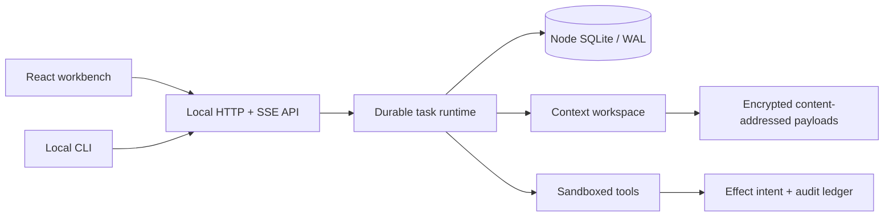

# NPA — Local-first Agent Workbench

NPA is a local-first AI agent harness for long-running tasks, recoverable context, and reviewable software changes. It combines a quiet React workspace with a durable Node.js runtime, built-in SQLite persistence, explicit approvals, and crash-safe checkpoints.

> The interface is currently Chinese-first. The runtime is single-user, local-only, and offline-first by design.

## Why NPA

- **Long-running task runtime** — durable runs, leases, heartbeats, retry backoff, budgets, checkpoints, pause/resume, and restart recovery.
- **Recoverable context workspace** — typed context blocks can be pinned, archived, offloaded, range-recovered, and verified by checksum without replacing the original payload with a lossy summary.
- **Development-agent loop** — Plan → isolated worktree → Diff → tests → review, with scoped run grants and approval gates for risky actions.
- **Unified task timeline** — messages, plan steps, tool requests/results, approvals, diffs, tests, checkpoints, commits, errors, and artifacts share one inspectable stream.
- **Local security boundary** — HttpOnly session cookies, CSRF protection, idempotency keys, path controls, SSRF defenses, secret redaction, encrypted payload storage, and an auditable side-effect ledger.
- **Self-contained Windows packaging** — the release workflow bundles a pinned Node.js runtime and publishes a launcher that does not require a separately installed .NET Desktop Runtime.

## Interface

The React + Vite + TypeScript frontend uses a responsive three-pane layout:

- a stable navigation rail for Today, Projects, Tasks, Knowledge, Automations, and Settings;
- a central task timeline and project workspace for Data, Canvas, Code, Terminal, and Git;
- a VISTA-inspired inspector for context pressure, typed blocks, recovery, usage, and run state.

The design supports dark mode, reduced motion, keyboard navigation, a `Ctrl+K` command palette, and single-column mobile layouts.

## Architecture



The server entry point only assembles the application. API routes, persistence, scheduling, model access, context management, worktrees, and security controls live in separate modules.

## Requirements

- Node.js `24.18.x`
- npm (bundled with Node.js)
- Windows 10/11 for the packaged desktop launcher
- .NET SDK 10 only when rebuilding the Windows launcher; end users of the packaged build do not need the .NET Desktop Runtime

## Run from source

```powershell
npm ci
npm run build
npm start
```

Open <http://localhost:3137>. Application data is stored locally and is excluded from Git.

For frontend development:

```powershell
npm run dev
```

## CLI

```powershell
node code-cli.js --self-test
node code-cli.js --help
```

The CLI uses a short-lived local token and talks to the same `/api/v1` runtime used by the browser interface.

## Build the Windows package

Project scripts keep downloaded runtimes, package caches, and temporary files inside the repository workspace.

```powershell
powershell -NoProfile -ExecutionPolicy Bypass -File tools/fetch-node-runtime.ps1
npm run package:win
```

The source repository intentionally does not include downloaded runtimes, local data, credentials, logs, caches, or generated release binaries.

## Verification

```powershell
npm run typecheck
npm test
npm run test:ui
npm run release:gate
```

The test suite covers the SQLite repository, state machine, budgets, run grants, the side-effect ledger, archive/recovery checksums, API authentication, SSE replay, model mocks, fault injection, worktrees, security regressions, and responsive UI smoke tests.

An accelerated fake-clock 72-hour soak test is included. A real wall-clock 72-hour soak remains a release qualification step, so this project does not yet claim that three-day stability has been proven under real elapsed time.

## VISTA clean-room provenance

The context workspace is a clean-room implementation based on the high-level mechanisms described by the VISTA paper and project page. No VISTA repository source code, file layout, or implementation detail has been copied.

- [VISTA paper](https://arxiv.org/abs/2606.30005)
- [VISTA project page](https://vista-agent.github.io/)
- [Detailed provenance note](docs/PROVENANCE.md)

## Security and privacy

- Never commit `.env` files, the `data/` directory, connector keys, logs, local agent configuration, downloaded runtimes, or packaged output.
- Treat model and connector credentials as local secrets. Configure them through the application rather than editing source files.
- Review every requested permission and diff before approving an external side effect.
- Report a suspected credential exposure privately and rotate the affected credential immediately.

## License

Unless otherwise noted, the source code in this repository is licensed under the [Apache License 2.0](LICENSE). Third-party names, logos, trademarks, and referenced materials remain the property of their respective owners.

## Current boundaries

NPA is currently a single-user local application. It does not provide multi-user tenancy, cloud synchronization, a general workflow-canvas product, or reinforcement-learning training. Merge, push, branch deletion, and other high-impact Git operations remain approval-gated.
